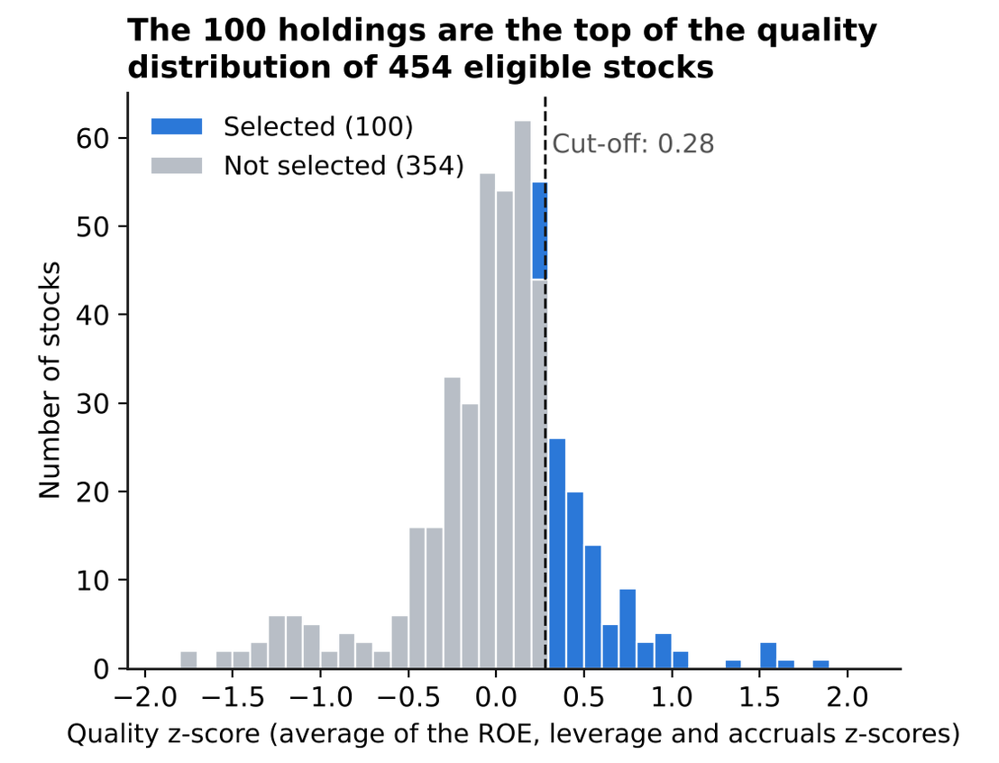
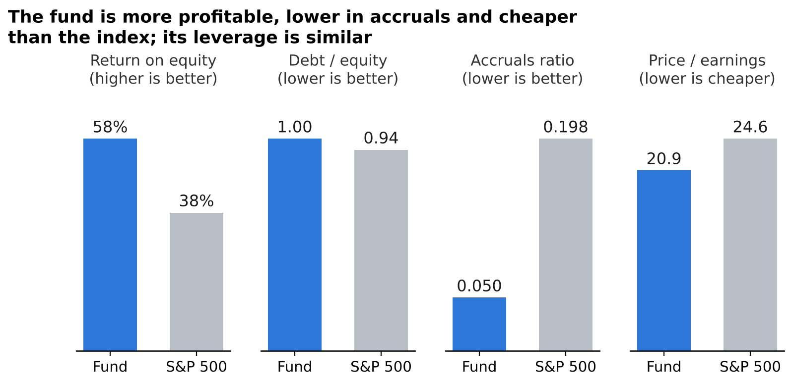
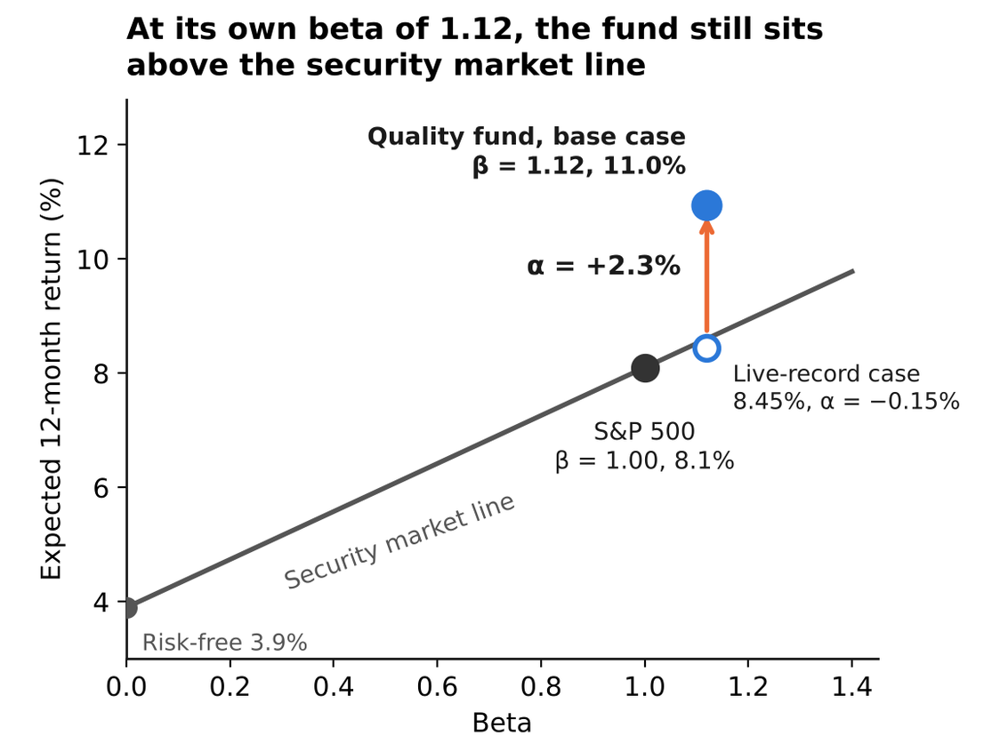

# EC4430 Portfolio Management: quality portfolio (Sections 5 and 6)

This repository holds the code that produces the figures and the risk–return table in the Portfolio Builder sections (5 and 6) of our EC4430 group essay, University of St Andrews, November 2026.

The fund follows the quality strategy of Ung, Luk and Kang (2014). It ranks the S&P 500 on three ratios: return on equity, the balance-sheet accruals ratio and financial leverage. Each ratio is winsorised at the 2.5th and 97.5th percentiles and turned into a z-score. The three z-scores are averaged into one quality z-score, and the fund holds the top 20% of the index on that score (100 stocks). Each holding is weighted by quality score × float market capitalisation, with caps of 5% per stock and 40% per sector. The portfolio itself was built in Excel with Bloomberg data downloaded on 16 November 2026, and these scripts read that workbook.

## Which file makes which part of the essay

The file names follow an earlier draft of the essay, so their numbers differ from the final essay. This table maps them:

| In the essay | Script | Output |
|---|---|---|
| Figure 1. Distribution of quality z-scores across the 454 eligible stocks | `fig2_quality_score_distribution.py` | `fig2_quality_score_distribution.png` |
| Figure 2. Quality and valuation characteristics of the fund against the S&P 500 | `fig4_quality_profile.py` | `fig4_quality_profile.png` |
| Figure 3. The fund against the security market line: base and live-record cases | `fig5_security_market_line.py` | `fig5_security_market_line.png` |
| Table 4. Expected 12-month risk and return of the fund against a passive S&P 500 holding | `table3_risk_return.py` | `table3_risk_return.csv` |

`fig1_selection_funnel.py` and `fig3_sector_weights.py` make two supplementary charts that are not used in the final essay.

## The figures

### Figure 1. Distribution of quality z-scores across the 454 eligible stocks
Made by `fig2_quality_score_distribution.py` from the *Scoring* sheet of the workbook.



### Figure 2. Quality and valuation characteristics of the fund against the S&P 500
Made by `fig4_quality_profile.py` from the *Scoring*, *Portfolio* and *Data* sheets. The fund is weighted by portfolio weight and the S&P 500 by float market capitalisation. Return on equity, debt/equity and accruals are weighted averages of the winsorised ratios. Price/earnings is the weighted harmonic mean on trailing 12-month EPS.



### Figure 3. The fund against the security market line: base and live-record cases
Made by `fig5_security_market_line.py`, with the same inputs as Table 4.



## Table 4. Expected 12-month risk and return of the fund against a passive S&P 500 holding

`table3_risk_return.py` computes the table and saves it as `table3_risk_return.csv`, which matches Table 4 of the essay. The inputs are set at the top of `risk_model.py`:

- **Fund beta, 1.12:** the portfolio-weighted Bloomberg adjusted beta (`EQY_BETA`, two years of weekly returns against the S&P 500), from `betas_bloomberg.csv`. It covers the 98 holdings that have a beta, 99.3% of the fund; FedEx Freight and Fifth Third had none.
- **Risk-free rate, 3.9%:** the midpoint of the Federal Reserve's 3.75–4.00% target range.
- **Expected S&P 500 return, 8.1%:** the 5.1% ten-year Treasury yield plus an assumed 3% equity risk premium.
- **Excess returns:** 2.85% (the index's long-run record) and 0.35% (its live record since 2014), both from Valantasis (2026).
- **Volatility and tracking error:** measured in the Bloomberg workbook from 104 weekly returns over the two years to 16 November 2026: 14.79% for the S&P 500, 18.75% for the current holdings at today's weights, and a tracking error of 7.18%. These use price returns; total returns would change them only marginally, as dividends are small and similar for the fund and the index.

## How to run

You need Python 3.9 or later, with the Bloomberg workbook `SP500_Quality_Portfolio_Builder_v2.xlsx` in the same folder as the scripts.

```bash
pip install -r requirements.txt
python make_all.py
```

`make_all.py` runs every script in order. Each script also runs on its own, for example `python fig2_quality_score_distribution.py`. The scripts print the numbers they plot, such as sector weights, the selection cut-off and the weighted ratios, so each one can be checked against the essay. Table 4 and Figure 3 need only `betas_bloomberg.csv`.

The workbook layout the scripts expect:

- **Scoring:** headers on row 4 and one row per S&P 500 line from row 5.
- **Portfolio:** headers on row 10 and one row per holding from row 11.
- **Data:** the raw Bloomberg fields from row 5. Column A is the ticker, column D the last price (`PX_LAST`) and column G the trailing 12-month EPS.

The workbook is not posted here because it contains Bloomberg data, which Bloomberg's terms do not allow to be republished. It is available on request.

## References

- Bloomberg L.P. (2026) *Bloomberg Terminal* [Database]. Accessed 16–17 November 2026.
- Jensen, M.C. (1968) 'The performance of mutual funds in the period 1945–1964', *Journal of Finance*, 23(2), pp. 389–416.
- S&P Dow Jones Indices (n.d.) *S&P Quality Indices Methodology*.
- Ung, D., Luk, P. and Kang, X. (2014) *Quality: A Distinct Equity Factor?* S&P Dow Jones Indices. Available at: https://ssrn.com/abstract=2472391.
- Valantasis, G. (2026) 'S&P 500 Quality Index: Why outperformance is only half the story', *Indexology Blog*, S&P Dow Jones Indices, 30 July.
